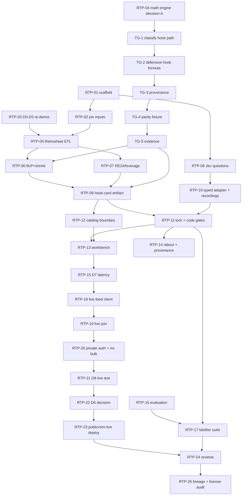

# Ring The Pen — ROADMAP

Executable plan for the build. Controlled by `AGENTS.md` and `docs/PRD.md` v0.1.2.
Everything here is grounded in the PRD, the sabr-jev predecessor, the-tango, and
the frozen Retrosheet inputs on disk; anything unknown is `TBD` with an early task
to establish it. No numbers are invented.

| Field | Value |
|---|---|
| Product | Ring The Pen (renamed from Pull Latch) |
| Controlling spec | `docs/PRD.md` v0.1.2 |
| Repo | greenfield `harlanljones/ring-the-pen` |
| Stack | Elixir + Phoenix LiveView (Bandit), Python Makefile ETL, `typesafe_api` / `jev-latest` + offline fixtures |
| Frozen pins | k=20 · N=3 · D1b reconstruct · universe A (`nump` present) · Elixir LiveView |
| Status | RTP-01, RTP-02, RTP-05 DONE, TG-1…TG-5 DONE. Decisions settled (DEC-6 deferred). Done 2026-09-21 PM: RTP-07, RTP-09, RTP-10 (recordings pending). Next unblocked: RTP-06 (BvP+shrink), then RTP-08, RTP-11, RTP-12 |

---

## 1. Current state

- The repository contains only `docs/PRD.md` (v0.1.2). It is not yet a git repo.
- No Elixir app, no ETL, no fixtures, no derived artifacts, no `NOTICE` exist.
- The **v0.1.1 Pull Latch PRD is not on disk** (the `tapowe-pull-latch-specs.tar.gz`
  copy is also v0.1.2), so the D0–D5 gate text is undefined; only the parenthetical
  `(formulas, BvP/shrink, pitch unknown, pen, lock, Brier/uncalibrated)` survives.
  Re-deriving D0–D5 is an explicit early decision gate (RTP-03).
- Retrosheet 2025 raw inputs exist under `/home/harlan/Downloads` and are
  **not yet pinned into the repo**:
  - `2025eve/` — 30 event files (15 `.EVA` + 15 `.EVN`) plus 30 `.ROS` roster
    files and `TEAM2025` (not event files). The directory holds 61 entries.
  - `2025box/` — box/roster files (`2025.EBA`, `2025.EBN`, `ANA2025.ROS`, …).
  - `2025plays/2025plays.csv` — 108 MB, 193,767 data rows, header includes `nump`
    and `pitches`.
  - `bevent.exe`, `bgame.exe` — Win32 Chadwick binaries (Linux execution unverified).
  - `bfiles.zip`, `2025_RE24_Values.csv` — team/ballpark files and 2025 RE24 states.
- Measured during planning (verify in RTP-05; do not trust as frozen):
  - Event-file `play` records: **216,845** across `2025eve`; **20,406 = 9.410%**
    have a blank 6th field (pitch sequence), but **20,405 of those are `NP`
    (non-plate-appearance) records**, so blank pitch there is *not* an unknown PA.
  - `2025plays.csv`: **193,767** data rows; literal `nump` column present.
    `pa=1` rows: **186,640**; of those `nump>0`: **186,127** (universe A
    candidate) and **513** have `nump` blank-or-zero (the real *unknown pitch
    count* class). Blank `nump` overall: **568 = 0.293%**.
- Predecessor `sabr-jev` is a verified, offline Elixir/Phoenix + Python ETL
  workbench with a confidence latch, typed Jev adapter, trusted catalog, immutable
  recordings, and a prospective evaluation ledger. It is the pattern to mirror,
  not copy.
- `the-tango` is an existing Python/NumPy engine modelling the three-batter
  minimum (`THREE_BATTER_MINIMUM = 3`, a rule not a tunable), BvP via odds-ratio
  (log5), starter decay (`N_THRESH`), bullpen fatigue, and wOBA→WPA leverage, with
  every constant carrying a `Provenance` marker and a production guard that
  refuses to serve uncalibrated parameters.
- `saberkit` is the Retrosheet ETL precedent: raw files never committed, derived
  constants pinned by revision + SHA-256, required notice in `NOTICE`.

## 2. Objective

Ship a workbench where, at a plate appearance, code assembles a hook card from
frozen precomputed state (Phase H) or polite live state (Phase L/P), TypeSafe Jev
returns a typed `Choice`/`Score`/`Noul`, and the confidence lock produces an
auditable verdict — with no falsifier triggered and no unlicensed redistribution.

## 3. Scope

- Phase H: historical Retrosheet universe A → hook card → Jev → lock → LiveView.
- Phase L: private, single-user/password late-season live via MLB Stats API
  `feed/live`, reusing the same card/lock.
- Phase P: public playoff URL **only** if D6 clears; otherwise the documented
  sim-live demotion.
- Evaluation: calibration-honest reporting (Brier by class, frozen baselines,
  reliability buckets, uncalibrated labeling).

## 4. Non-goals

- Live Fangraphs scrape; chat scout / chat writeup; Jev computing any number.
- Public redistribution of the MLB Stats API live feed before D6.
- Claiming Retrosheet is live, or selling "instant from pitch release".
- Threshold/lock calibration claims before an evaluation report exists.
- A general game-tree solver or a full pinch-hit optimizer (that is `the-tango`).

## 5. Assumptions (evidence-backed; verify before relying)

| # | Assumption | Evidence / status |
|---|---|---|
| A1 | Retrosheet event-file `play` record field 6 is the pitch sequence. | Verified on `2025eve/2025ANA.EVA`: `play,1,0,kwans001,01,CX,63/G6`. |
| A2 | Blank pitch sequence in event files is largely *non-PA*, not unknown pitches. | 20,405 / 20,406 blank `play` lines are `NP`; only the one non-`NP` blank is a balk. |
| A3 | `2025plays.csv` carries a literal `nump` **and** a `pa` flag. | Header includes both; among `pa=1`, 186,127 have `nump>0` and 513 are unknown. |
| A4 | Event files and `2025plays.csv` are **different populations**. | 216,845 `play` records vs 193,767 CSV rows; blank pitch 9.410% (mostly `NP`) vs blank `nump` 0.293%; **which is authoritative is DEC-3**. |
| A5 | `bevent.exe` runs on Linux. | **UNVERIFIED** — it is a Win32 binary; RTP-05 must test or choose a fallback. |
| A6 | `sabr-jev` command pattern transfers. | Documented and evidenced in `sabr-jev/GATES.md` (97 Elixir + 23 Python tests); not yet reproduced here. |
| A7 | the-tango formulas are reusable but uncalibrated. | `params.py` marks nearly all hot-path constants `GUESS`/`PRD_DEFAULT`; guard raises on production. |
| A8 | MLB Stats API `feed/live` exists; license is individual/non-commercial/non-bulk. | PRD audit (`statsapi.mlb.com/api/v1.1/game/{gamePk}/feed/live`; `copyright.txt`). |

## 6. Decision log

Decided 2026-09-21. Each decided item has a record under `docs/decisions/`.
Open items still block their downstream tasks.

| ID | Decision | Status | Chosen / note | Blocks |
|---|---|---|---|---|
| DEC-1 | D0–D5 gate text. | **ACCEPTED** | `docs/gates/D0-D5.md` APPROVED 2026-09-21 (delegated). | D-gate claims |
| DEC-2 | Math engine. | **ACCEPTED — A** (+ `TG-*` completion milestones) | `docs/decisions/0001-math-engine.md`: precompute in Python ETL reusing the-tango formulas; Elixir lock. Blocked until the-tango completion milestones finish. | RTP-06, 08 |
| DEC-3 | Universe A authority. | **ACCEPTED — C** (both, reconcile) | `docs/decisions/0002-universe-a.md`: `2025plays.csv` is the counting authority; event files cross-check and supply D1b lineup. | RTP-05 |
| DEC-4 | Parser path. | **ACCEPTED — A+C** (stdlib + CSV, cross-check with Chadwick `cwevent`) | `docs/decisions/0003-parsing.md`: stdlib/CSV primary; build `cwevent` and reconcile on the same games. | RTP-05 |
| DEC-5 | Lock thresholds τ. | **ACCEPTED (provisional)** | `docs/decisions/0008-lock-thresholds.md`: 0.8/0.5 Choice/Score, 0.85 Noul, labeled provisional. | RTP-11 exit |
| DEC-6 | Phase P license path. | **DEFERRED to publish** | `docs/decisions/0006-phase-p-license.md`: no license now; no public URL; revisit at publish. | RTP-22, 23 |
| DEC-7 | Shrink prior + `k=20` provenance. | **ACCEPTED** | `docs/decisions/0007-bvp-shrink.md` + `docs/research/bvp-shrink.md`: credibility blend; `k` split into `k_display=20` / fitted `k_shrink`; prior = odds-ratio expected rate, Marcel 3-yr. | RTP-06 |
| DEC-8 | Injury / pen source. | **ACCEPTED — A+C** | `docs/decisions/0004-pen-source.md`: Stats API box+roster **and** a third-party source for availability; Phase H uses Retrosheet box usage + explicit unknown availability. | RTP-07, 11 |
| DEC-9 | D1b lineup scope. | **ACCEPTED** | `docs/decisions/0009-d1b-lineup.md`: historical-first from `start`/`sub`; live may be partial. | RTP-08, 18 |
| DEC-10 | Phase L in-season BvP refresh. | **ACCEPTED — A** | `docs/decisions/0005-phase-l-bvp-refresh.md`: scheduled daily precompute from the in-season PBP source; no bulk archive; freshness recorded. | RTP-19 |

All decisions are now settled; DEC-6 is deferred to publish. The remaining
blockers are execution (TG-1…TG-5 for the-tango, then RTP-06/07/08), not choices.

## 7. Metrics

Baselines marked `TBD` are genuinely unknown and must be established by the listed
task. Measured planning facts are cited as provisional baselines, not targets.

| Metric | Baseline | Target / threshold | Measurement method | Owner | Cadence |
|---|---|---|---|---|---|
| Frozen input integrity | 0 pinned (empty repo) | every input SHA-256 + revision + row count verified; Retrosheet notice in `NOTICE` | RTP-02 verify script | Data ETL | per data change |
| Universe A row count | TBD (candidates: 186,127 `pa=1 & nump>0` CSV rows; event-file-derived) | one frozen, reproducible count asserted by ETL | row-count assertion in `make data` | Data ETL | per ETL run |
| Unknown pitch-count class | 513 CSV rows (`pa=1 & nump∈{blank,0}`) | never counted as 0; explicit unknown state preserved end to end | ETL invariant + negative test | Data ETL | per ETL run |
| BvP shrink correctness | none | credibility blend `(n·x̄+k_shrink·m)/(n+k_shrink)` (DEC-7); `w_bvp`/`w_prior` exposed; `k_display=20` flags underqualified | hand-computed unit fixtures | Judgment/Lock | per change |
| Lock routes from frozen recordings | none | every recorded card yields `act`/`review`/`escalate`; underqualified sample can never `act` | offline replay tests | Judgment/Lock | per change |
| Jev numeric invention | n/a | 0 numeric fields computed by Jev | state allowlist + schema tests | Judgment/Lock | per change |
| Falsifier violations | unknown | 0 | `mix test` negative suite (RTP-17) | Parent | per merge |
| `feed_delay` | TBD | displayed (D7) | latency instrumentation | Workbench | per live test |
| `state_build_ms` | TBD | displayed (D7) | latency instrumentation | Workbench | per live test |
| `jev_rtt_ms` | TBD | displayed (D7); post-state-ready ≤1–2s typical | latency instrumentation | Workbench | per live test |
| `ui_paint_ms` | TBD | displayed (D7) | latency instrumentation | Workbench | per live test |
| Poll interval | TBD | 2–5s, polite, no bulk archive | client config + test | Live ingest | per live test |
| Brier (Noul classes) | TBD | report by class + baseline Brier + reliability buckets; label uncalibrated | evaluation module | Evaluation | per cycle |
| Prospective capture cutoff | none | capture strictly before Jan 1 of outcome season | ledger refusal tests | Evaluation | per cycle |
| Public live redistribution | prohibited | 0 until D6 clears in writing | `/about` + deploy review | Parent | per release |

## 8. Phases and milestone exit gates

Phases mirror PRD §1. Milestones are exit-gated; do not advance on activity.

| Phase | Milestone | Exit condition |
|---|---|---|
| — | **M0 Governance** (RTP-01–04) | Commands verified (done); inputs pinned (done); **D0–D5 text APPROVED (DEC-1, done)**; DEC-2 recorded (done). |
| — | **M0b the-tango completion** (TG-1–TG-5) — **DONE** | Hook path classified, defensive formula implemented, provenance set, parity fixture pinned, evidence recorded. **Blocks M1's BvP.** |
| H | **M1 Historical data spine** (RTP-05–08) | Frozen hook-card artifact + provenance; universe A count frozen; unknown≠0 invariant enforced. |
| H | **M2 Offline lock end-to-end** (RTP-09–12) | Recorded card → lock verdict offline; Jev/pitch/Noul falsifier negative tests green. |
| H | **M3 Phase H workbench** (RTP-13–15, 17) | D0–D5 and D7 checks pass; `/about` honest; no full page reload on new state. |
| H | **M4 Evaluation honesty** (RTP-16) | Brier report with frozen baselines; no calibration claim. |
| L | **M5 Phase L private live** (RTP-18–21) | **D8** one live `gamePk` private test; no bulk archive; polite poll; latency measured. |
| P | **M6 Phase P decision** (RTP-22–23) | **DEFERRED to publish (DEC-6):** no license now, no public URL. At publish: auth/licensed path or sim-live demotion with `/about` text; no public Stats API redistribute. |
| — | **M7 Release quality** (RTP-24–25) | Independent spec then quality review approve; full suite + formatter + strict compile green. |

## 9. Traceability: falsifiers and gates → work items

### 9.1 PRD falsifiers

| Falsifier | Preventing work items | Negative test |
|---|---|---|
| Retrosheet claimed as live | RTP-02, RTP-14 | RTP-17 |
| Public Stats API live redistribute without D6 | RTP-22, RTP-23 | RTP-17, RTP-24 |
| "Instant from pitch" | RTP-14, RTP-15 | RTP-17 |
| Jev invents rates/counts | RTP-09, RTP-10, RTP-12 | RTP-17 |
| Pitch-count stop as Noul | RTP-09, RTP-11 | RTP-17 |
| Blank `nump` as pitches | RTP-02, RTP-05 | RTP-17 |
| No lock | RTP-11, RTP-13 | RTP-17 |

### 9.2 Gates

| Gate | Requirement | Work items |
|---|---|---|
| D0 formulas | `/about` formulas + `formula_version`; math in code only | RTP-03, RTP-04, RTP-14 |
| D1 BvP/shrink | credibility blend (DEC-7); `k` split `k_display=20`/`k_shrink`; weights shown; D1b lineup reconstruct (DEC-9) | RTP-06, RTP-08 |
| D2 pitch unknown | blank sequence / missing `nump` is unknown, never 0; universe A frozen | RTP-05, RTP-08 |
| D3 pen | bullpen availability/fatigue; empty-pen hard gate | RTP-07, RTP-11 |
| D4 lock | Choice/Score primary; Noul secondary act/review only; code gates not overridable | RTP-11, RTP-13 |
| D5 Brier/uncalibrated | Brier by class + frozen baseline + buckets; explicitly uncalibrated | RTP-16 |
| D6 Phase P license | auth / licensed / sim-live demotion in `/about` | RTP-22, RTP-23 |
| D7 latency panel | `feed_delay` + `state_build_ms` + `jev_rtt_ms` + `ui_paint_ms` shown | RTP-15 |
| D8 Phase L live test | one live `gamePk`, private, no bulk archive | RTP-20, RTP-21 |

## 10. Dependency graph, critical path, concurrency

**Critical path:** RTP-01 → RTP-02 → RTP-05 → **TG-1…TG-5** → RTP-06/07 → RTP-08
→ RTP-11/12 → RTP-13 → RTP-15 → RTP-18 → RTP-19 → RTP-20 → RTP-21 → RTP-22 →
RTP-23 → RTP-24. (All decisions settled; the TG milestones are the remaining
pre-RTP-06 blocker.)

**Concurrency waves (disjoint exclusive ownership):**

| Wave | Parallel items | Disjoint ownership |
|---|---|---|
| W0 | RTP-01, RTP-02, RTP-03, RTP-04 | app skeleton / `data/`+`NOTICE` / `docs/gates/` / `docs/decisions/` |
| W1 | RTP-05, RTP-09 | `scripts/**` vs `lib/ring_the_pen/{questions,judgments}.ex` |
| W2 | RTP-06, RTP-07, RTP-10 | serial on `scripts/**`; parallel judgment path |
| W3 | RTP-08, RTP-11, RTP-12 | ETL artifact vs lock math vs catalog |
| W4 | RTP-13, RTP-14, RTP-15, RTP-16 | web / `/about` / instrumentation / evaluation |
| W5 | RTP-18 → RTP-21 | `lib/ring_the_pen/live/**` (single writer, serial) |
| W6 | RTP-22, RTP-23 | `docs/gates/D6` + deploy config |
| W7 | RTP-24, RTP-25 | review + docs audit |

## 11. Work items

Each item lists: depends · owner role · exclusive ownership · deliverable ·
validation · measurable exit. One writer per file.

### M0 — Governance

**RTP-01 — Scaffold the Elixir/Phoenix app**
- Depends: — · Owner: Scaffolder
- Owns: `mix.exs`, `mix.lock`, `.formatter.exs`, `config/**`,
  `lib/ring_the_pen/application.ex`, `lib/ring_the_pen_web.ex`,
  `lib/ring_the_pen_web/**` skeleton, `assets/**`, `test/**` skeleton, `.gitignore`.
- Deliverable: minimal runnable LiveView app on Bandit with `app: :ring_the_pen`,
  `RingThePen`/`RingThePenWeb`, and no canned fake stats.
- Validation: `mix deps.get && mix format --check-formatted && mix compile --warnings-as-errors && mix test`.
- Exit: `BUILD_PASS` and an offline `mix test` green; commands published in
  `AGENTS.md`; git repo initialized (no commits unless asked).
- Status (2026-09-21): **DONE** — format 0, compile 0, `mix test` 3 passed, assets
  built; git initialized on `master` (no commits).

**RTP-02 — Pin, checksum, and attribute the inputs**
- Depends: RTP-01 · Owner: Data ETL
- Owns: `data/**` (manifest + `.gitignore`), `NOTICE`, `docs/data-sources.md`,
  `scripts/verify_inputs.py`.
- Deliverable: manifest of Retrosheet 2025 inputs (revision/path + SHA-256 + row
  counts), bulk raw untracked, `NOTICE` carrying the required Retrosheet
  attribution. No bulk raw committed.
- Validation: verify script recomputes digests and fails closed on mismatch.
- Exit: every pinned input verifies; missing input is a hard failure; notice present.
- Status (2026-09-21): **DONE** — 5 inputs pinned in `data/manifest.json`;
  `make verify-inputs` all OK; negative test (empty dir) exits 1; `NOTICE` +
  `docs/data-sources.md` present; raw bulk gitignored.

**RTP-03 — Re-derive D0–D5 gate text (decision gate)**
- Depends: RTP-01 (naming) · Owner: Planner
- Owns: `docs/gates/D0-D5.md`.
- Deliverable: exact text for D0 formulas, D1 BvP/shrink (+D1b lineup), D2 pitch
  unknown, D3 pen, D4 lock, D5 Brier/uncalibrated, each with `CHECK` and `EXPECT`,
  re-derived from the PRD parenthetical, falsifiers, and sabr-jev precedent; the
  v0.1.1 gap stated explicitly.
- Validation: each gate has a runnable check and expected output.
- Exit: Harlan approves in writing; no D0–D5 claim without this record.
- Status: **draft written** (`docs/gates/D0-D5.md`); **DEC-1 still OPEN**.

**RTP-04 — Decide math-engine reuse vs port (decision gate)** — **ACCEPTED: Option A**
- Depends: RTP-01 · Owner: Planner + math owner
- Owns: `docs/decisions/0001-math-engine.md`.
- Deliverable: inventory of the-tango formulas needed (odds-ratio BvP,
  wOBA→WPA/leverage, starter decay, bullpen fatigue, three-batter minimum) and the
  chosen path. **Chosen:** precompute in the Python ETL reusing the-tango formulas;
  Elixir owns shrink/gates/lock.
- Exit: DEC-2 recorded (**done, Option A**). Card math is not written until the
  `TG-*` completion milestones below land.

### M0b — the-tango completion (external, blocking)

DEC-2 chose to reuse `the-tango`, so its hook path must be **finished** before any
hook-card number is trusted. These milestones live in the `the-tango` repo (owner:
math owner); they block RTP-06 and RTP-08. Each records evidence in this repo under
`docs/decisions/0001-math-engine.md` (appendix).

**TG-1 — Classify the hook path.** Inventory each needed formula as reuse / adapt /
new; the defensive hook hazard is **new** (the-tango's `hazard_hook_probability` is
the opponent's self-hook risk, `compas.py:167`). Output: appendix table.
- Exit: every hook-card input mapped to a named function or marked NEW.

**TG-2 — Implement the defensive hook formula (NEW).** Add our-pitcher removal
hazard to the-tango engine with unit/property tests.
- Exit: tested function exported; no magic constants without `Provenance`.

**TG-3 — Provenance on the hook path.** Calibrate or explicitly label every
hot-path constant used by the hook path (`CALIBRATED`/`PRD_DEFAULT`/`GUESS`); the
production guard must not silently serve uncalibrated values.
- Exit: hook path either calibrated or served only with the uncalibrated label.

**TG-4 — Cross-engine parity fixture.** Reproduce `the-tango/tests/golden/prd_request.json`
and freeze a hook-path golden vector for the ETL/Elixir boundary.
- Exit: parity fixture passes in the-tango and is pinned by digest here.

**TG-5 — Evidence.** Re-run the-tango suite + latency; record output here.
- Exit: suite green; evidence quoted in `0001-math-engine.md`.

### M1 — Historical data spine (Phase H)

**RTP-05 — Retrosheet ingest + universe A audit**
- Depends: RTP-02, DEC-3 (settled), DEC-4 (settled) · Owner: Data ETL
  (RTP-03/D2 gate *text* approval is not required to build the ETL; DEC-3 fixes
  the substance.)
- Owns: `scripts/etl.py`, `scripts/metrics.py`, `tests/**` (Python), `data/derived/**`.
- Deliverable: deterministic offline ingest of 2025 Retrosheet. **DEC-3 = C:**
  `2025plays.csv` is the counting authority (`pa=1 & nump>0`); event files
  cross-check and supply the D1b `start`/`sub` lineup data. The unknown class
  (`pa=1 & nump∈{blank,0}`) is kept unknown. **DEC-4 = A+C:** stdlib parser + CSV
  primary, Chadwick `cwevent` built and reconciled on the same games.
- Validation: `make data` offline reproduces byte-identically; row counts match the
  manifest; reconciliation report reconciles CSV vs event-file vs `cwevent` counts;
  negative test proves unknown pitch count ≠ 0 and an `NP` blank is never an
  unknown PA.
- Status (2026-09-21): **DONE** — core (`scripts/etl.py`, `verify_inputs.py`,
  `tests/test_universe_a.py`) + Chadwick `cwevent` cross-check
  (`scripts/crosscheck_cwevent.py`, 2,430 games, 0 mismatches) + D1b lineup
  extraction (`scripts/lineup.py`, `tests/test_lineup.py`, DEC-9 algorithm;
  `data/derived/lineup_summary.json` lineup/1). All `make data` artifacts
  byte-identical; 38 Python tests OK.
- Exit: D2 satisfied and DEC-3/DEC-4 recorded; reproducible counts, no network.

**RTP-06 — BvP + shrink tables (credibility, DEC-7)**
- Depends: RTP-05, **TG-1…TG-5** · Owner: Data ETL
- Owns: BvP/shrink ETL modules + tests.
- Deliverable: precomputed BvP `n`/`x̄` plus the credibility blend
  `(n·x̄ + k_shrink·m)/(n + k_shrink)` per `docs/decisions/0007-bvp-shrink.md`;
  prior `m` via the-tango odds-ratio/marcel machinery; `k_shrink` **fitted from
  the artifact** (placeholder ~1000 labeled `uncalibrated` until then);
  `k_display = 20` as the underqualified gate; `w_bvp`/`w_prior`, `m`, `k_shrink`
  provenance in the artifact.
- Validation: hand-computed unit fixtures at the `k_display` 19/20/21 boundary
  (flag) and weight-sum tests against `k_shrink`; `k_shrink` fit reproduced from
  the artifact; no constant presented as calibrated.
- Exit: D1 satisfied; weights + prior + `k_shrink` provenance present for the lock/UI.

**RTP-07 — RE24 / leverage / wOBA→WPA bridge**
- Depends: RTP-05 · Owner: Data ETL
- Owns: leverage/re24 ETL modules + tests.
- Deliverable: 2025 run-expectancy states from `2025_RE24_Values.csv`, leverage
  inputs, and the wOBA→WPA bridge constants, each with provenance.
- Validation: RE24 states reproduce the source table; bridge constants match the
  cited convention (any GUESS/PRD_DEFAULT label preserved).
- Exit: leverage inputs available for the card and pen gate; no unlabeled constant.
  (D3 pen itself is satisfied by RTP-11; this item supplies its numeric inputs.)
- Status (2026-09-21): **DONE** — `scripts/re24.py` + `tests/test_re24.py`;
  `data/derived/re24_leverage.json` (re24-leverage/1); 24 base-out states match
  the pinned source (sha recorded); every constant provenance-labeled;
  byte-identical regeneration.

**RTP-08 — Frozen hook-card artifact + provenance**
- Depends: RTP-06, RTP-07 · Owner: Data ETL
- Owns: `priv/data/hook_cards.json`, artifact schema doc.
- Deliverable: `{schema_version, provenance, cards:[...]}` with exact keys, source
  digests, `formula_version`, license, purpose, and `judgment_state` free of
  identity/outcomes; D1b reconstruct lineup (N=3) per the DEC-9 historical scope.
- Validation: artifact schema test; outer metrics equal judgment-state metrics;
  counts equal sample values.
- Exit: D1/D1b/D2 reflected in the frozen artifact; catalog (RTP-12) can load it.

### M2 — Offline lock (Phase H)

**RTP-09 — Frozen Jev question pack**
- Depends: RTP-01, RTP-03 · Owner: Jev boundary
- Owns: `lib/ring_the_pen/questions.ex`, `priv/jev/**` schema.
- Deliverable: Choice `pull_decision`, Score `hook_urgency`, Noul
  `danger_pa_now`/`danger_window_next3` with frozen criteria text; state/question
  hashing; allowlisted state only.
- Validation: schema tests reject identity/outcome/oracle keys; `other` option
  present on the Choice.
- Exit: question hashes stable; no math in questions.
- Status (2026-09-21): **DONE** — `lib/ring_the_pen/questions.ex` +
  `test/ring_the_pen/questions_test.exs` (16 tests; Choice includes `other`,
  key allowlist rejects identity/outcome/oracle, unknown pitch count ≠ 0) +
  frozen pack `priv/jev/questions/v1.json`.

**RTP-10 — Typed adapter + immutable recordings**
- Depends: RTP-09 · Owner: Jev boundary
- Owns: `lib/ring_the_pen/judgments.ex`, recording task, `priv/jev/recordings/**`.
- Deliverable: fail-closed typed adapter validating Choice/Score/Noul shapes,
  probabilities, confidence rules, and raw-vs-serialized agreement; immutable real
  recordings.
- Validation: offline replay with **no** `TYPESAFE_API_KEY`; recorded fixtures
  validated against frozen cards.
- Exit: offline lock UI tests need no key; synthetic vs recorded clearly separated.
- Status (2026-09-21): **DONE, recordings pending** — `lib/ring_the_pen/judgments.ex`
  fail-closed adapter + offline replay, 36 Elixir tests green with no
  `TYPESAFE_API_KEY`. Synthetic fixtures in `priv/jev/fixtures/synthetic/`
  (README-labeled, `synthetic--` prefix); `priv/jev/recordings/` is empty and a
  test enforces provenance separation — real recordings still to be captured.

**RTP-11 — Confidence lock + hard code gates**
- Depends: RTP-08, RTP-10 · Owner: Lock math
- Owns: `lib/ring_the_pen/{lock,gates}.ex`.
- Deliverable: Choice/Score drive act/review/escalate; Noul act/review only and
  never escalates; `other` → escalate; underqualified sample cannot act; pitch-cap
  (only when known), injured, and empty-pen are deterministic code gates that Jev
  cannot override.
- Validation: unit tests per rule + negative tests that a gate cannot be expressed
  as a Noul.
- Exit: D4 satisfied; thresholds labeled provisional unless D4 says otherwise.

**RTP-12 — Trusted catalog boundary**
- Depends: RTP-08 · Owner: Catalog
- Owns: `lib/ring_the_pen/catalog.ex`.
- Deliverable: loader enforcing exact outer keys, `id == role:player_id:year`,
  outer/state metric equality, count/sample equality, oracle/state consistency.
- Validation: boundary tests rejecting each mutation class.
- Exit: no card reaches lock or UI without passing the catalog.

### M3 — Phase H workbench

**RTP-13 — Workbench LiveView**
- Depends: RTP-11, RTP-12 · Owner: Web
- Owns: `lib/ring_the_pen_web/**` workbench, `assets/**`.
- Deliverable: hook-card render (pitcher, count, N=3 upcoming, BvP/shrink weights,
  code-gate state), lock verdict with full probabilities; under review/escalate show
  all probabilities and no single bold recommendation; audit trail (state hash,
  questions hash, model, recorded_at).
- Validation: LiveView tests for every lock route and empty/unknown states.
- Exit: no card route renders without a lock; falsifier "no lock" exercised.

**RTP-14 — `/about` formulas, provenance, license status**
- Depends: RTP-12 · Owner: Web
- Owns: `lib/ring_the_pen_web/**` about page.
- Deliverable: published formulas + `formula_version`, data provenance, Retrosheet
  notice, current phase and license status, and explicit "uncalibrated" labeling.
- Validation: content tests; no claim of calibration, no Retrosheet-as-live text.
- Exit: D0 surface satisfied; falsifiers "Retrosheet as live" and "instant from
  pitch" absent.

**RTP-15 — D7 latency panel**
- Depends: RTP-13 · Owner: Workbench
- Owns: latency instrumentation + panel.
- Deliverable: display `feed_delay`, `state_build_ms`, `jev_rtt_ms`, `ui_paint_ms`;
  document that "instant" = no full page reload.
- Validation: instrumentation test with synthetic timings; copy review.
- Exit: D7 satisfied; NFR wording matches PRD §4.

### M4 — Evaluation

**RTP-16 — Brier / uncalibrated reporting**
- Depends: RTP-11 · Owner: Evaluation
- Owns: `lib/ring_the_pen/evaluation.ex`, evaluation docs.
- Deliverable: Brier by class, frozen baseline Brier, reliability buckets, coverage
  and missingness; prospective capture cutoff before the outcome season; missing
  outcomes pending, never negative.
- Validation: refusal tests (historical enrollment, late capture, mixed cutoffs);
  report states accuracy pending.
- Exit: D5 satisfied; no calibration claim before outcomes.

**RTP-17 — Falsifier negative test suite**
- Depends: RTP-11, RTP-13 · Owner: Parent/Reviewer
- Owns: falsifier test module(s).
- Deliverable: one negative test per PRD §7 falsifier.
- Validation: `mix test` includes all seven; each asserts the forbidden behavior is
  rejected or absent.
- Exit: all seven green; results recorded with exact output.

### M5 — Phase L private live

**RTP-18 — Live feed client**
- Depends: RTP-13, RTP-15 · Owner: Live ingest
- Owns: `lib/ring_the_pen/live/**` client.
- Deliverable: resolve `gamePk`; polite poll/diff of
  `statsapi.mlb.com/api/v1.1/game/{gamePk}/feed/live` at 2–5s; map pitcher, pitch
  count (unknown-preserving), lineup/on-deck, inning, score; cache politely.
- Validation: recorded feed fixture replay offline; unknown pitch count stays unknown.
- Exit: live state maps to the same state JSON as Phase H with no math in the client.

**RTP-19 — Live join with precomputed BvP/shrink**
- Depends: RTP-18, RTP-08 · Owner: Live ingest
- Owns: live join module.
- Deliverable: join precomputed BvP/shrink/leverage to live state and feed the same
  card/lock path.
- Validation: parity test — same card inputs as Phase H produce the same lock route.
- Exit: "same card/lock" claim is true and tested; if DEC-10 is unresolved, the
  BvP freshness date is shown and labeled stale, never silently served as current.

**RTP-20 — Private access + no-bulk guard**
- Depends: RTP-18 · Owner: Live ingest
- Owns: auth/config for Phase L.
- Deliverable: single-user/password access; no bulk archive dump; polite poll
  enforced; Retrosheet never labeled live.
- Validation: tests refusing bulk export and unauthenticated access.
- Exit: license-honest Phase L surface.

**RTP-21 — D8 one live gamePk private test**
- Depends: RTP-20 · Owner: Parent
- Owns: D8 record.
- Deliverable: one live `gamePk` private run; measured D7 metrics; no bulk archive.
- Validation: recorded evidence (timings, screenshots/log) attached to the gate record.
- Exit: D8 satisfies; metrics stay uncalibrated-labeled.

### M6 — Phase P decision

**RTP-22 — D6 decision record**
- Depends: RTP-21 · Owner: Planner + Harlan
- Owns: `docs/gates/D6.md`.
- Deliverable: dated plan — MLBAM written auth requested by a specific date, or
  licensed feed procured, or sim-live demotion (delayed box / end-of-inning with a
  stated staleness bound and exact `/about` sentence), with evidence.
- Status: **DEFERRED to publish** (`docs/decisions/0006-phase-p-license.md`); no
  license now, RTP-23 stays blocked.
- Validation: decision cites `copyright.txt` terms; no public Stats API redistribute
  without written auth.
- Exit: D6 resolved in writing or Phase P explicitly blocked.

**RTP-23 — Public deploy (or documented demotion)**
- Depends: RTP-22 · Owner: Web/Deploy
- Owns: deploy config + `/about` Phase P text.
- Deliverable: if D6 cleared, public URL on the licensed path; otherwise the
  sim-live demoted build with `/about` saying so.
- Validation: no unlicensed live feed served; `/about` text matches the D6 record.
- Exit: Phase P license-honest.

### M7 — Release quality

**RTP-24 — Independent spec then quality review**
- Depends: RTP-17, RTP-23 · Owner: Reviewer
- Deliverable: spec review (matches PRD) then quality review (matches standards);
  parent re-runs the full offline suite, formatter, strict compile, and gate checks.
- Exit: both reviews approve; max three cycles then escalate.

**RTP-25 — Lineage, notice, and footer audit**
- Depends: RTP-24 · Owner: Data ETL + Web
- Owns: `NOTICE`, provenance docs, footer.
- Deliverable: every derived artifact carries digests/`formula_version`/license;
  `NOTICE` complete; UI labels provisional/uncalibrated; no bulk data committed.
- Exit: lineage audit clean; no secret or bulk-data commit.

## 12. Integration checkpoints

| Checkpoint | After | Required evidence |
|---|---|---|
| CP-0 | M0 | Verified commands; D0–D5 text; DEC-2; input digests. |
| CP-H1 | RTP-08 | Frozen hook-card artifact loads; schema + count invariants pass. |
| CP-H2 | RTP-12 | Recorded card → lock route offline; catalog rejects mutations. |
| CP-H3 | RTP-15 | D0–D5 + D7 checks with exact output; Phase H falsifiers green. |
| CP-H4 | RTP-17 | All seven falsifier negative tests green; D5 report present. |
| CP-L1 | RTP-21 | D8 live test evidence; D7 measured; no bulk archive. |
| CP-P1 | RTP-23 | D6 record + `/about` text; no unlicensed redistribute. |
| CP-F | RTP-24 | Spec + quality reviews; full suite, formatter, strict compile green. |

## 13. Risks

| Risk | Trigger | Mitigation |
|---|---|---|
| Data-source disagreement changes universe A | Event plays (216,845) vs CSV rows (193,767); blank 9.410% vs 0.293% | RTP-05 audit freezes DEC-3 in D2; document, never silently pick. |
| Event-file blank pitch mistaken for unknown PA | 20,405 blank `play` lines are `NP` | RTP-05 requires `pa` flag; negative test guards the `NP` case. |
| Phase L BvP stale (precomputed join) | In-season games not in annual Retrosheet files | DEC-10 sources an in-season refresh or labels BvP stale in the UI. |
| `bevent.exe` unusable on Linux | ETL cannot execute it | DEC-4: use `2025plays.csv`, Chadwick `cwevent`, or a stdlib parser; document. |
| D6 unresolved, public URL requested | No written MLBAM auth | Block RTP-23 public; ship sim-live demotion; say so in `/about`. |
| Uncalibrated constants presented as actionable | the-tango params are `GUESS`/`PRD_DEFAULT` | Carry provenance; label uncalibrated; D5 report; no accuracy claim. |
| Jev computes a number | State field derived rather than precomputed | RTP-09/10 allowlist + RTP-17 negative test. |
| Blank pitch sequence treated as 0 | Missing `nump`/blank seq defaulted | RTP-05 invariant + RTP-17 test; unknown is explicit state. |
| Pitch-count stop becomes a Noul | Gate phrased as a Jev question | RTP-11 code gate + RTP-17 test. |
| Latency overclaim | Copy implying pitch-release instantaneity | RTP-14/15 + RTP-17 test. |
| Fixture/API drift (`typesafe_api` alpha, `jev-latest`) | Upgraded dep breaks recordings | Pin versions; immutable recordings; offline suite is the contract. |
| Missing input or API | Absent pinned file / unreachable service | Blocker: report and stop; never fabricate. |
| Rename drift ("latch" vs "lock") | Stale predecessor language | Terminology in `AGENTS.md`; audit in RTP-25. |
| Bulk raw or secrets committed | `.gitignore` gap | RTP-02 guard; RTP-25 audit. |

## 14. Decision gates summary

| Gate | Meaning | Owner | Artifact | Blocking |
|---|---|---|---|---|
| D0 | Formulas | RTP-03 | `docs/gates/D0-D5.md` | Card math, `/about` |
| D1 | BvP/shrink (+D1b lineup) | RTP-03 | same | RTP-06, RTP-08 |
| D2 | Pitch unknown / universe A | RTP-03, RTP-05 | same | RTP-05, RTP-08 |
| D3 | Pen | RTP-03, RTP-07 | same | RTP-11 |
| D4 | Lock | RTP-03, RTP-11 | same | RTP-13 |
| D5 | Brier / uncalibrated | RTP-03, RTP-16 | same | Public claims |
| D6 | Phase P license | RTP-22 | `docs/gates/D6.md` | RTP-23 |
| D7 | Latency panel | RTP-15 | gate record | Phase H UI exit |
| D8 | Phase L live test | RTP-21 | gate record | Phase L exit |
